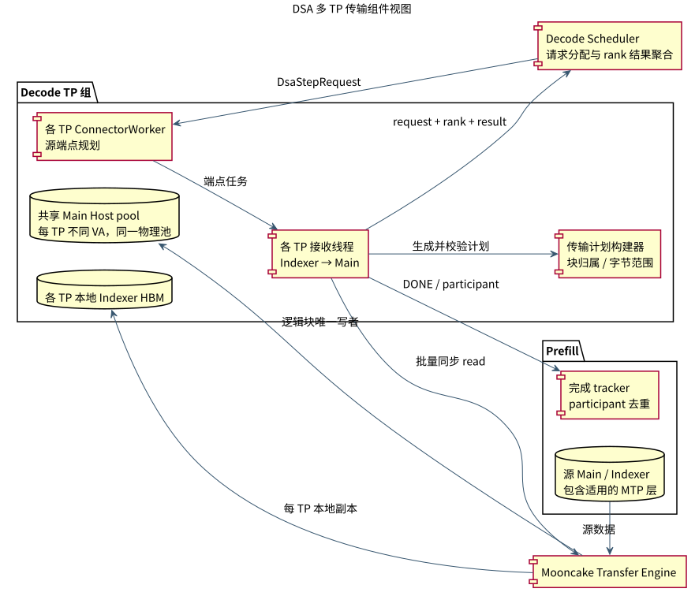
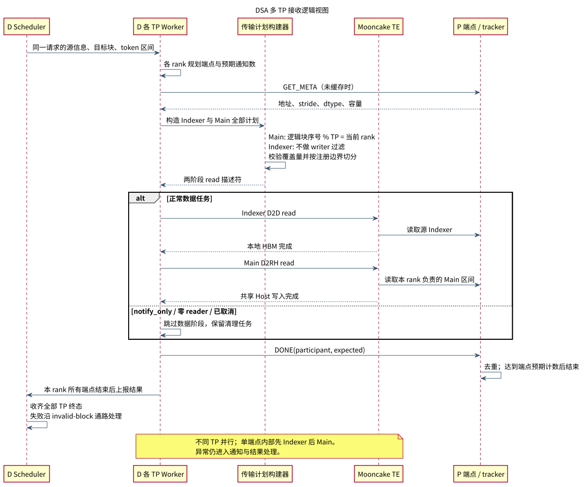

# DSA P/D 多 TP 并行传输设计

## 1. 背景、目标与范围

现有 blockwise DSA 接收路径由 Decode TP0 承担共享 Main KV 的写入，传输压力集中在单个 rank。随着上下文长度增加，P→D 接收可能成为请求进入 Decode 的瓶颈。

本方案将 Main KV 接收扩展为所有 Decode TP 按逻辑块分工，利用多个传输端点并行搬运；Indexer 由每个 TP 接收到自己的 HBM，供本地索引计算使用。P 表示 Prefill，D 表示 Decode；Main 为主注意力 KV，Indexer 为稀疏索引缓存。

设计目标：

- Main 共享物理块具有唯一写者，接收范围完整且不重复。
- 支持 prefix 命中、非连续物理块和适用的 MTP 层组件。
- 多 TP 接收、取消和失败均能收敛到明确终态，P 端缓存不会因通知计数错误而提前释放。
- 注册区域与传输描述符满足 Mooncake 的大小和边界要求。

本方案仅覆盖 Main KV 与 Indexer cache，不设计独立的 hidden-state 传输协议。Decode 每步新生成 KV 的共享 Host 回写继续由 TP0 执行；其数据在各 TP 间复制，无需重复写回。

### 设计选择

采用“共享 Main 池加逻辑块分工”，避免为每个 TP 复制完整 Host KV。按全请求逻辑块序号确定写者，使分工不依赖物理分配位置，也不随 prefix 命中区间变化。源端点选择复用普通 Mooncake 的规划规则，目标写入所有权单独计算。

## 2. 组件视图



[PlantUML 源文件](diagrams/tp_components.puml)

| 组件 | 职责与关键接口 |
| --- | --- |
| `_MooncakeDsaDecodeScheduler` | 为请求绑定 Host/HBM block ID；发出一次性 `DsaStepRequest`；汇总所有 D TP 结果 |
| `MooncakeConnectorWorker` | `_plan_dsa_endpoints()` 复用普通 Mooncake 源端选择；为本 rank 派发端点任务 |
| `KVCacheRecvingThread` | 获取布局元数据，执行 Indexer/Main 两阶段读取，发完成通知 |
| `mooncake_dsa_transfer.py` | `DsaCacheLayout` 描述组件；`build_component_read()` 生成字节地址及长度 |
| `MooncakeHostPool` | 共享物理 Host pool；每个 TP 使用自己的 NPU 可寻址视图，校验相对偏移一致 |
| `GlobalTE` 与 P 端 tracker | 内存注册/注销、批量读取；按 participant 去重计数，延迟释放 P 端缓存 |

组件之间以请求元数据、布局描述和带 rank 的完成结果交互，避免传递其他进程的本地虚拟地址。

## 3. 逻辑视图与数据分工



[PlantUML 源文件](diagrams/tp_logic.puml)

1. Scheduler 根据已计算 token 数与外部命中 token 数定义区间 `[num_computed_tokens, num_computed_tokens + num_external_tokens)`，下发源拓扑及两类目标块。
2. 各 D TP 选择 P 端点；源端选择与目标写入分工分别计算。没有 Main 数据可写的端点任务仍保留完成语义，避免 P 端等待无法到达的通知。
3. 接收线程先构造并校验两个阶段的全部组件计划，再提交读取。按 PP 层区间选择组件，最后一个 P stage 的范围包含 draft 层。
4. Indexer 先执行 D2D，写入当前 TP 的 HBM；Main 再执行 D2RH，写入当前 TP 映射的共享 Host pool。跨 TP 并行，每个端点内部按阶段调用 `batch_transfer_sync_read()`。
5. 所有本地端点任务结束后，上报带 `tp_rank` 的结果；Scheduler 收齐所有预期 D TP 的结果后形成接收终态。失败通过 invalid-block 通路上报，终态不等同于数据成功可用。

### 3.1 唯一写者规则

设 token 的全请求目标逻辑块序号为 `j`，D 的 TP 数为 `T`：

```text
Main 写者：j % T == tp_rank
CP 源分片：global_source_block % cp_size == cp_rank
```

例如 D TP=4，目标逻辑块 0～7 分别由 TP0 写 0/4、TP1 写 1/5、TP2 写 2/6、TP3 写 3/7。判断依据是**全请求逻辑序号**，不是目标物理 block ID，也不是裁剪后的区间序号，因此 prefix 命中和非连续物理块不会改变所有权。

Indexer 不应用此写者过滤；每个 TP 都需要自己的完整目标区间。Main 的共享物理块只写一次，Indexer 的各 rank 副本分别写入。P/D 块大小、页比例、stride、dtype 与每 token 字节数必须兼容；计划还检查实际总字节数等于预期覆盖量。

### 3.2 本地地址与注册边界

各 rank 的虚拟地址允许不同，不能把 TP0 的绝对指针广播后当成本地地址使用。Host pool 描述比较的是 segment 偏移、容量、组件相对偏移、shape、dtype 与 stride。

注册区域按组件实际跨度生成，安全合并同一存储中的区间；超过 64 GiB 的区域分段，传输条目在本地或远端注册边界处再切分。Host location 使用对应 `npu:<device_id>`，普通 HBM 使用 `*`；统一调用三参数 `register_memory(ptr, size, location)`，依赖支持该签名的 Mooncake。

## 4. 完成、失败与资源生命周期

- **双层完成协议：**D 侧按 request/rank 聚合；P 侧按端点的预期 reader 数和唯一 participant 聚合。重复通知不重复计数，已结束请求的迟到通知不重建状态。
- **零读取与全 prefix 命中：**TP0 为零 reader 端点发送清理任务；`notify_only` 跳过数据读取，但保留释放通知。
- **取消与失败：**共享取消事件阻止后续阶段；异常记录 `INDEXER_D2D` 或 `MAIN_D2RH`，仍尝试向 P 端发送完成通知。invalid block 使用上游 cache group 0 的 ID 空间，不能拿 Host block ID 替代。
- **关闭：**停止元数据服务，排空接收队列并等待线程/执行器退出，最后注销注册内存。注销失败的区域保留以供重试。
- **待解决的注册回滚：**必须明确部分注册失败的清理策略。若仅在整个循环成功后记录区域，中途失败会遗漏已注册区域；实施时需逐项记录成功结果并验证逆序清理。该异常路径作为独立验收项。

MTP 诊断输出组件覆盖、缓存样本和投机状态。DEBUG 样本中的 `.item()` / `.tolist()` 可能引入设备同步，性能测量应关闭这类诊断。

## 5. 收益与验收

预期收益来自 Main 接收带宽的并行使用，不是减少 Main 总字节数。短区间可能只有部分 TP 获得 Main 块；端点带宽、共享 DRAM 和 Indexer 复制流量也会限制加速，不能直接承诺 TP 倍提升。

| 验收项 | 验收标准 |
| --- | --- |
| 块覆盖 | token 裁剪、不同块几何、非连续物理块下，Main 无重叠且完整；Indexer 各 rank 内容一致 |
| 注册边界 | 超过 64 GiB 的区域正确切分，单条传输不跨任一端注册边界 |
| 完成协议 | 重复、迟到、零 reader 通知不误计数；未收齐全部 rank 终态时不得提前结束 |
| 异常与资源 | 注入各阶段失败、取消、部分注册失败和注销失败，验证状态收敛及资源释放 |
| NPU 集成 | 对比源端与各 rank Indexer、共享 Main 内容，覆盖 prefix 命中和 MTP |
| 性能 | 固定 P/D 拓扑和请求长度，对比 TP0 方案的接收耗时、每 rank 字节数、TTFT；关闭 DEBUG |

CP/PP 源覆盖检查应在提交传输前完成；部署支持范围需与实际配置校验一致，并逐项完成端到端验收。

## 6. 实施安排

1. 定义 rank-aware 请求/结果元数据、本地 Host 视图与唯一写者规则，先验证地址和字节覆盖。
2. 接入多端点两阶段接收、完成计数及取消/失败处理，确保请求生命周期闭环。
3. 加入有界注册、关闭与异常清理、MTP 诊断，再执行多 TP 正确性和性能验收。
