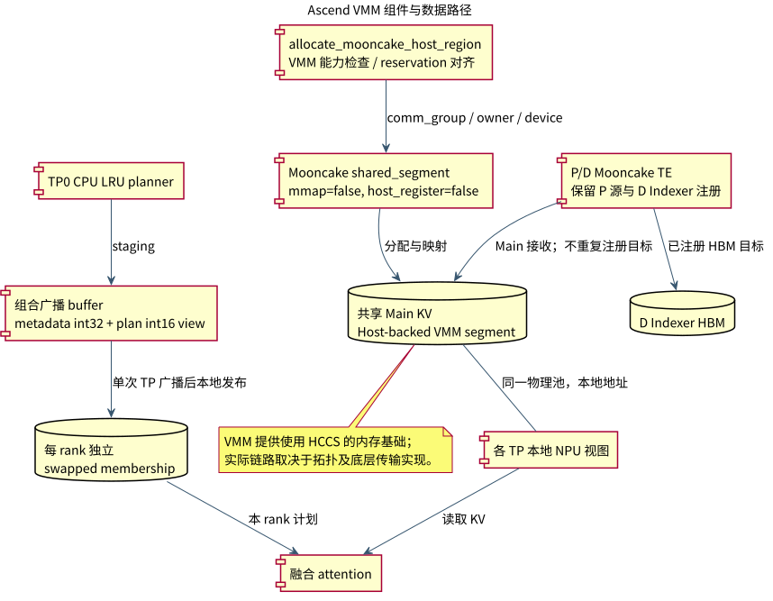
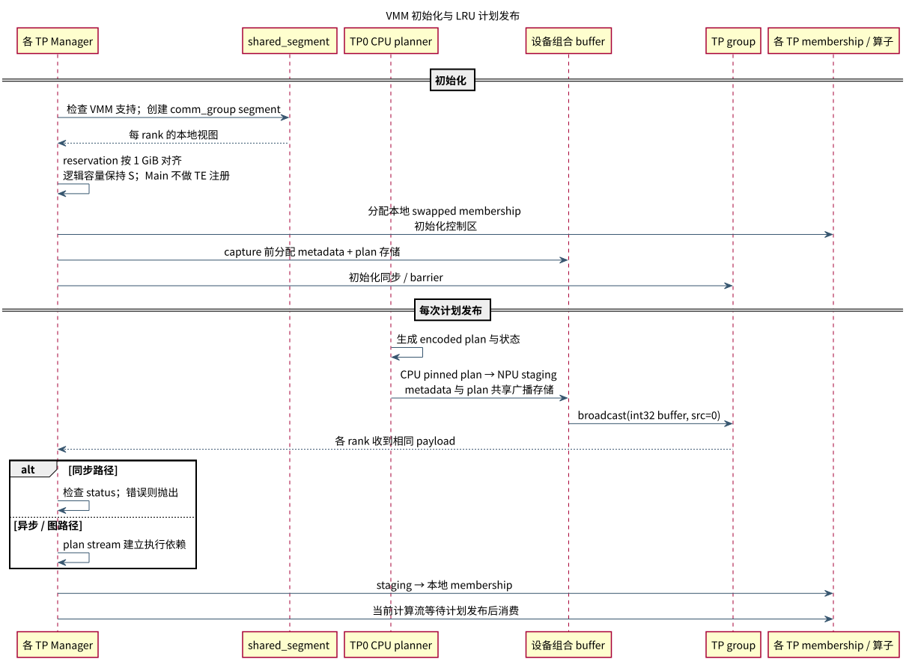

# Mooncake Ascend VMM 共享内存设计

## 1. 背景、目标与范围

现有 Decode Main KV 使用 mmap 加 host-register 的共享内存方式。为使共享 Host KV 适配 Ascend 的内存访问能力，本方案改用 Ascend VMM shared segment，为支持的拓扑使用 HCCS 数据路径提供内存基础，降低对 RoCE 路径的依赖。

改造范围包括三部分：VMM 分配与注册边界、各 TP 的 membership 存储、LRU 计划发布。Main 的逻辑块所有权、P/D 请求协议及上层 KV 容量语义保持一致。

设计目标：

- 各 TP 使用本地 NPU 可寻址视图访问同一共享 Main KV，逻辑容量与地址对齐满足要求。
- VMM Main 与普通 Indexer HBM 采用各自正确的注册策略。
- 每个 TP 的融合算子获得一致的 LRU 计划，计划发布满足图执行的预分配和流依赖要求。
- 合并 metadata 与 encoded plan 广播，减少控制面 collective 开销。

**链路约束：**本方案不在 connector 中增加路由选择器。HCCS 可用性由 Ascend/Mooncake 能力及部署拓扑决定；跨非 HCCS 域的 P/D 通信仍需按实际传输路径部署和测量。

### 设计选择

Main KV 继续共享以控制容量开销；membership 表采用每 rank 独立的 swapped tensor，避免跨 rank 依赖相同虚拟地址。CPU planner 与算子通过设备 staging 衔接，再用一次 TP 广播发布 metadata 和计划。

## 2. 组件视图



[PlantUML 源文件](diagrams/vmm_components.puml)

| 组件 | 设计职责 |
| --- | --- |
| `allocate_mooncake_host_region()` | 检查 VMM 支持，建立共享 segment，返回满足对齐的逻辑容量视图 |
| `MooncakeHostPool` | 承载全量 Main KV；各 TP 使用本地映射地址访问同一物理共享区域 |
| Mooncake connector / `GlobalTE` | D 侧仅注册普通 Indexer HBM；P 侧源缓存注册保留 |
| `SparseKVOffloadManager` | 分离 CPU planner 存储、设备 staging 和各 TP 的算子 membership 表 |
| TP group | 协调 segment 建立、初始化屏障与计划广播 |

## 3. 内存模型与分配协议

| 项目 | 现有方案 | 目标方案 |
| --- | --- | --- |
| shared segment 模式 | `mmap=True, host_register=True` | `mmap=False, host_register=False` |
| 组参数 | `tp_group=` | `comm_group=` |
| reservation | 逻辑大小加 alignment padding | 含 padding 后向上取整到 1 GiB |
| D Main 注册 | 合并后调用 TE 注册 | VMM Main 不重复注册 |
| D Indexer 注册 | 本地 HBM 注册 | 保留本地 HBM 注册 |
| membership 表 | 共享 Host segment | 每 rank 独立 swapped tensor |

设逻辑容量为 `S`，要求的地址对齐为 `A`：

```text
reservation = ceil((S + A - 1) / 1 GiB) * 1 GiB
logical_base = align_up(segment_base, A)
logical_size = S
```

1 GiB 是地址 reservation 约束，不能直接解释为每次都新增 1 GiB 有效 KV 容量。分配函数仍只暴露长度 `S` 的视图，池内子分配继续检查边界。创建时保留 owner rank 和各 rank 的 device ID；TP>1 必须提供通信组。

`shared_segment_supported(mmap=False, host_register=False)` 不满足时直接报错，不自动退回 mmap。VMM 路径不再设置 `VLLM_ASCEND_SKIP_MIGRATEPAGES`。

D 侧 `_dsa_consumer_indexer_register_regions()` 仅提取 Indexer 的有界 HBM 区间；没有待注册区间时跳过注册调用。这里的“免注册”仅指 VMM Main，不能推广到所有 Mooncake 缓存。

## 4. 逻辑视图与 LRU 一致性



[PlantUML 源文件](diagrams/vmm_logic.puml)

**KV 数据面：**P 的源缓存经既有 Mooncake 接收计划写入 D 的 VMM Main；各 D TP 通过自己的视图读取。传输地址不得用其他 rank 的绝对虚拟地址替代。沿用 Main 的逻辑块所有权与 P/D 完成协议。

**计划控制面：**Main KV 保持物理共享，membership 表改为每 rank 独立。TP0 的 CPU planner 在 pinned CPU 表中生成 encoded plan，复制到设备 staging；所有 TP 接收广播，再把 plan 写入各自的 swapped membership 表，供融合算子消费。

`empty_aligned_swapped_tensor()` 依赖 `torch_npu.empty_with_swapped_memory`，让 Host-backed 存储通过本地 NPU tensor 暴露。各 rank 初始化控制区并同步，再进入 TP barrier；无需把 TP0 的 membership 指针当成其他 rank 的地址。

### 单次广播布局

```text
一个预分配 int32 buffer
├─ metadata：status + current linear slots（int32）
└─ encoded plan：同一 storage 的 int16 view
   shape = [row_capacity, topk + control_count]
```

metadata 保持 int32，plan 保持 int16 字节表示；广播整个 int32 buffer，实现一次 collective 携带两类内容，避免每 step 额外打包和 dtype 转换。缓冲在 graph capture 前分配。

异步/图路径在 plan stream 上完成 staging、广播与本地发布，再由当前计算流等待；同步路径广播后检查 status，再发布计划。同步路径保留 `.item()` 状态读取，不能据此宣称所有模式均无 CPU/NPU 同步。

## 5. 失败、资源与性能边界

- VMM 能力缺失、TP 通信组缺失、非法容量或对齐条件：初始化失败，不静默换回原内存路径。
- planner 与算子不共享同一存储时，必须存在 staging/broadcast buffer；缺失即报错。同步 planner 异常通过 status 广播传播。
- `close()` 清除 membership、staging、metadata 等引用，再关闭 Host allocator；连接器仍需遵循先排空传输再注销资源的既有顺序。
- 主预期收益是让内存访问适配更高带宽路径，并减少一次计划广播；具体带宽和延迟由 HCCS 拓扑、DRAM 带宽及请求规模共同决定。
- 每 rank 的 membership 副本增加存储开销；共享 KV 本体不按 TP 复制。

## 6. 验收标准

| 验收项 | 验收标准 |
| --- | --- |
| VMM 参数与边界 | 验证模式选择、1 GiB reservation 对齐、逻辑容量、TP 通信组及池内分配边界 |
| 注册责任 | D Main 不重复注册；D Indexer HBM 正常注册，空注册列表不触发调用 |
| 计划一致性 | 各 rank 收到相同 metadata/plan；分别验证同步、异步和图执行的发布顺序 |
| 异常路径 | 缺少 VMM/swapped-memory 能力、通信组或 staging 时明确失败；planner 错误不被当作有效计划消费 |
| 广播成本 | 对比拆分广播与组合广播的耗时，并统计新增 membership 副本和 staging 的内存占用 |
| HCCS 路径 | 通过实机路由或链路计数器确认传输路径，不能仅凭配置名称判断 |
| 端到端 | 比较 mmap/VMM 的 P/D 吞吐、延迟及 KV 内容；在相同硬件和请求负载下评估收益 |

## 7. 实施安排

1. 切换 shared segment 分配参数及通信组接口，加入 reservation 对齐与逻辑视图边界检查。
2. 调整 D 端注册责任，验证 Main 接收与各 rank 本地访问。
3. 分离 planner、staging 与 membership，合并广播并建立流依赖。
4. 验证资源释放、图执行与链路选择，再进行端到端性能对比。
