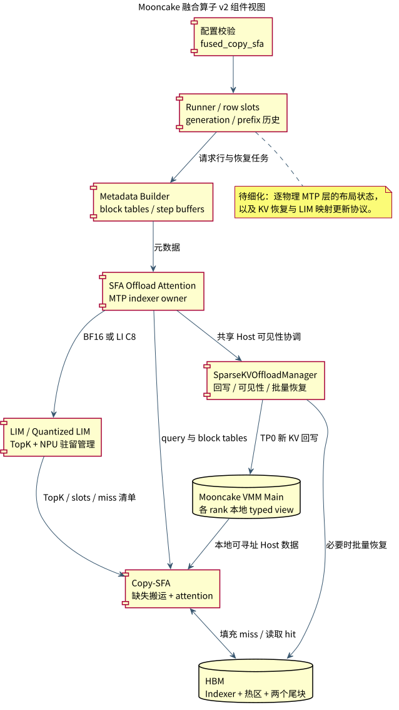
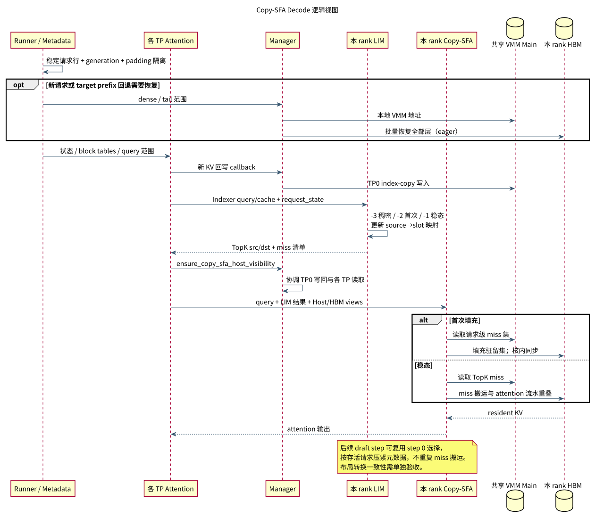

# Mooncake 融合算子 v2 集成设计

## 1. 背景、目标与范围

现有 fused overlap 路径依赖 CPU LRU planner 生成驻留与搬运计划，需要在 CPU、设备 staging 和各 TP 间传递控制信息。随着 Decode 并发和 MTP query 数增加，这部分调度开销会限制融合收益。

本方案在 Mooncake 加 Ascend VMM 的稀疏 KV offload 路径中接入 LIM 和 Copy-SFA：由 LIM 在 NPU 上完成 TopK 与 HBM 驻留管理，由 Copy-SFA 融合缓存缺失搬运和稀疏注意力。正常 Decode 不再逐步构建 CPU LRU 计划。

设计范围：

- 集成 BF16 LIM、量化 LIM 和 Copy-SFA 算子及 serving 接口。
- 建立请求独占行、generation、HBM 热区与循环尾块布局。
- 适配 Mooncake VMM 本地地址、新 KV 回写和 TP 可见性协调。
- 支持 MTP 选择复用、图执行及必要的 dense/tail 恢复。

v2 指融合算子及其 serving 路径；本方案使用 Model Runner V1。Ascend VMM 共享 Host pool 为前置能力。

### 设计选择

采用 NPU LIM 管理 source→slot 映射，避免稳态 Decode 的 CPU LRU 往返；采用 Copy-SFA 在算子内部协调 miss 搬运与 attention，减少独立搬运阶段。共享 Host 全量 KV 与每 rank HBM 热区分开管理，当前 token 回写仍保留独立接口。

初始化及 prefix 回退恢复放在 eager 元数据阶段，稳态路径不重复恢复。MTP 各物理层的布局转换必须作为独立正确性问题处理，不能仅用 target prefix 历史推断所有层的布局。

## 2. 组件视图



[PlantUML 源文件](diagrams/kernel_components.puml)

| 组件 | 核心职责 |
| --- | --- |
| `SparseKVOffloadConfig` | 选择 `fused_copy_sfa`，校验预算、模型及运行模式 |
| Runner 与 `copy_sfa_topk_slots.py` | 分配请求行、generation、prefix 历史；准备 dense/tail 恢复任务 |
| `AscendSFAOffloadMetadataBuilder` | 构建按 step 预分配的元数据、Host/HBM block table、尾部描述符 |
| SFA offload attention 与 MTP proposer | 调用 LIM/Copy-SFA；共享 indexer owner，压紧并复用 draft step 0 的选择 |
| `SparseKVOffloadManager` | VMM typed view、本地地址绑定、新 KV 回写、TP 可见性 fence、批量恢复 |
| 三个 C++/Ascend 算子 | BF16 LIM、量化 LIM、fused scatter-copy sparse flash attention |

## 3. 逻辑视图



[PlantUML 源文件](diagrams/kernel_logic.puml)

### 3.1 一次 Decode 的主路径

1. Runner 为活跃请求保留稳定 pool row 和 generation；换请求复用行时重置生命周期状态，padding 使用独立 dummy rows。
2. metadata builder 准备稳定前缀、缓存容量、逻辑长度、请求状态和两类 block table。首次进入或 target prefix 回退时，必要的 dense/tail 恢复在 eager 元数据阶段执行。
3. 各层生成当前 KV；共享 Host KV 仍由 TP0 通过 Mooncake index-copy 路径回写。读取共享 Host 前执行 TP 可见性协调。
4. LIM 根据 Indexer cache 产生 `topk_src_ids`、`topk_dst_slots`、每 query miss 前缀和请求级 miss 清单，并原地更新 `cache_slots_pool`。
5. Copy-SFA 使用当前 rank 的 VMM Host view 和 HBM hot buffer，完成缺失搬运及 attention。输出按实际 query heads 裁剪。

BF16 路径调用 `npu_fused_lightning_indexer_manage`；LI C8 路径调用 `npu_fused_quant_lightning_indexer_manage`。两者都接入 `npu_fused_scatter_copy_sparse_flash_attention`。量化的是 Indexer query/cache；Main KV 仍为 BF16。

### 3.2 驻留状态与布局

| 状态 | LIM 行为 | KV 要求 |
| --- | --- | --- |
| `-3` 非卸载/稠密 | identity mapping，miss 数为 0 | HBM 已按 source 顺序保存稠密内容 |
| `-2` 首次卸载 | TopK union 加补充项建立容量 C 的驻留集 | Copy-SFA 先填满驻留集再执行 attention |
| `-1` 稳态卸载 | hit/miss、union、淘汰及 slot 更新 | 只搬运缺失项，复用已有驻留内容 |

每个请求的 HBM 行包含热区 `C` 加两个 128-token 循环尾块。全量历史 Main 保存在 VMM Host pool，Indexer 保留在 HBM。行的逻辑 slot、Host source token 与两侧物理 block table 分别表达，不能混用。

Copy-SFA 的首次填充路径通过核内同步保证搬运完成后再读取；稳态路径让缺失搬运与 attention 流水重叠。这属于算子内部数据依赖，不替代 TP 间共享 Host 写回的可见性同步。

### 3.3 MTP 与图执行

同一请求的多个 query 连续排列，LIM 对稳定 prefix 计算多路 TopK union。后续 draft step 可以复用 step 0 的 LIM 结果；proposer 按存活请求压紧 source/destination 行，保留对应逻辑长度和 cache budget，复用时不重复发起 miss 搬运。

元数据与基础地址在 capture 前准备；Mooncake writeback 描述符按 forward/draft 布局复用，同一布局跨层共享，target 与 draft 需要区分。`lru_max_threads` 不控制新路径的 NPU 驻留管理。

## 4. Mooncake 适配与恢复

**本地 VMM 地址。**`bind_copy_sfa_kv_cache()` / `_bind_copy_sfa_bases()` 绑定各 rank 自己的 Host/HBM 地址。Mooncake 不调用 MemFabric 的 `sparse_copy()`；错误地进入该接口会明确报错。

**批量恢复。**`_copy_sfa_local_ranges()` 将 token offsets 与每层 K/V 基址组合为设备描述符，以一次 `batch_memcpy_kernel` launch 覆盖所有层和有效范围。零长度项不访问内存；目标范围依赖请求独占行保证不重叠。普通稳定 Decode 不重复执行恢复。

**独立回写。**TP0 继续回写新生成 KV；融合 attention 不能替代这一步。Host typed writeback view 额外保留 sink row 处理无效槽位，逻辑 KV 容量不因此扩大。`ensure_copy_sfa_host_visibility()` 在读共享 Host 前协调写回完成。

**fallback 隔离。**保留完整 device KV 的 colocate 调试模式使用独立 resident fallback arena，避免 CPU planner 覆盖 Copy-SFA 驻留行，额外容量计入 profiling。Mooncake 配置要求 `keep_device_kv_cache=false`，其支持范围限定为 P/D 分离的 Decode；colocate mixed-batch 隔离用于保留 device KV 的调试路径。

## 5. 配置与约束

拟采用以下 Decode `additional_config` 配置接口，还需配置原有 blockwise DSA Mooncake connector；仅修改 `host_backend` 不会自动选择 connector。

```json
{
  "enable_sparse_li_c8": false,
  "sparse_kv_offload_config": {
    "enabled": true,
    "host_backend": "mooncake",
    "fused_op_type": "fused_copy_sfa",
    "use_fused_overlap": false,
    "keep_device_kv_cache": false,
    "topk_buffer_size": 8192,
    "dram_size_per_dp_GB": 128
  }
}
```

| 条件 | serving 约束 |
| --- | --- |
| TopK / block size | 2048 / 128 |
| 每请求 query 数 | `Q_max = 1 + num_speculative_tokens`，范围 1～7 |
| 热区 C | 256 对齐，`Q_max × 2048 ≤ C ≤ 16128`；MTP3 最少 8192 |
| 最大模型长度 | 2097152 |
| 数据类型 | BF16 Main KV；BF16 LIM 或 INT8 query/cache 加 FP16 scales 的量化 LIM |
| 互斥/不支持 | 与原 `use_fused_overlap` 互斥；不支持 DSpark、CP、PP、Model Runner V2、FP8 Indexer、SFA C8 Main KV |

serving 的 query 上限按整条路径的约束确定，不直接沿用单个算子的独立上限。`enable_sparse_li_c8=true` 才选择量化 LIM。

## 6. 设计风险与待解决问题

### 6.1 MTP 布局转换一致性

仅依赖 Runner 的 CPU computed-prefix 历史，不能完整表达每个物理 MTP 层的驻留布局。需要重点处理两类转换：

- 稀疏行在没有 target-prefix 回退时进入 `-3` 稠密寻址，KV 可能仍按稀疏 slot 顺序存放。
- 全层 eager refill 将 draft 行写成稠密布局，但该层 LIM 映射可能仍描述此前的稀疏布局。

实施前需明确逐物理层的布局状态、恢复范围及映射重建时机，保证 KV 物理内容与 LIM 映射同步转换。这部分设计尚需细化；BF16 / LI C8、eager / graph 均必须通过对应场景后，才能将完整 MTP 布局转换列入支持范围。

### 6.2 资源与运行边界

请求行回收必须更新 generation 并清除旧 prefix 历史；padding 行不得覆盖活跃请求。恢复描述符的目标区间必须互不重叠，零长度项不得访问内存。共享 Host 读取前必须建立 TP0 写回完成的依赖；算子内部同步不能替代 TP 间可见性协调。

性能评估应分别统计首次填充、prefix 回退恢复和稳态 Decode。HBM 驻留表、请求行、尾块及调试 fallback arena 都需计入容量规划。

## 7. 验收标准

| 验收层次 | 验收标准 |
| --- | --- |
| 配置与元数据 | 非法预算和运行组合在启动时拒绝；请求行、generation、padding 和 block table 对应关系正确 |
| Mooncake 接线 | 各 rank 使用自身 VMM 地址；跨层恢复覆盖完整；writeback、可见性协调和描述符复用顺序正确 |
| 算子正确性 | 分别验证 BF16/量化 LIM 的 TopK、驻留映射、miss 清单，以及 Copy-SFA 输出与参考计算一致 |
| MTP 与布局转换 | 覆盖多物理层 sparse→dense→sparse、prefix 回退、请求重排/行复用；对比非卸载基线输出 |
| 图执行 | eager 与 capture/replay 结果一致；target/draft 描述符隔离；复用选择时不重复 miss 搬运 |
| fallback | 调试 fallback arena 与 Copy-SFA 驻留行不重叠，切换后内容正确 |
| 性能 | 对比原 fused overlap 的稳态 Decode 延迟、Host 搬运字节、CPU planner 时间及 HBM 占用 |

配置保留原 fused overlap 路径，便于对照验收及回退。未通过布局转换验收的运行组合不进入发布支持范围。

## 8. 实施安排

1. 集成三个算子的 Torch 绑定、元数据接口及配置校验，先完成算子参考结果对比。
2. 接入请求行、驻留状态、block tables 与 MTP 选择复用，落实逐物理层布局转换方案。
3. 适配 VMM typed view、独立回写、TP 可见性协调和跨层批量恢复。
4. 验证图执行、异常边界和 fallback 隔离，完成正确性门槛后再进行性能验收。
