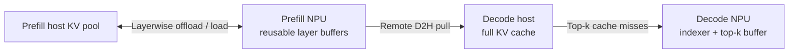

# Layerwise and Sparse KV Cache Offloading Guide

Layerwise and sparse KV cache offloading are supported only in disaggregated
Prefill/Decode (PD) deployments. Colocated Prefill/Decode serving is not supported.

This guide explains how to configure:

- Layerwise KV cache offloading during the Prefill phase
- Sparse KV cache offloading during the Decode phase
- Combining both features in a disaggregated Prefill/Decode deployment

For the underlying architecture and implementation details, see
[Layerwise and Sparse KV Cache Offloading Design](../../developer_guide/Design_Documents/layerwise_and_sparse_kv_cache_offloading.md).

## Supported Models

The combined deployment currently supports the following sparse-attention
model families:

- [GLM-5.1](../../tutorials/models/GLM5.md)
- [GLM-5.2](../../tutorials/models/GLM5.2.md)
- [DeepSeek-V3.2](../../tutorials/models/DeepSeek-V3.2.md)

Other sparse-attention models have not been validated.

## 1. Preparation

### Prefill Nodes

=== "A3 series"

    Prefill offload relies on memcache service. Here we provide a simple guidance to launch memcache service. Configure `mmc-meta.conf`:

    ```ini
    ock.mmc.meta_service_url = tcp://<META_HOST>:5000
    ock.mmc.meta_service.config_store_url = tcp://<CONFIG_STORE_HOST>:6000
    ock.mmc.meta.lease_ttl_ms = 30000
    ock.mmc.log_level = error
    ```

    Configure `mmc-local.conf` on every Prefill node:

    ```ini
    ock.mmc.meta_service_url = tcp://<META_HOST>:5000
    ock.mmc.local_service.config_store_url = tcp://<CONFIG_STORE_HOST>:6000
    ock.mmc.log_level = error
    ock.mmc.local_service.world_size = 256
    ock.mmc.local_service.protocol = device_sdma
    ock.mmc.local_service.dram.size = 10GB
    ```

    Start MetaService in a separate process:

    ```bash
    export MMC_META_CONFIG_PATH=/path/to/config/mmc-meta.conf
    python -c "from memcache_hybrid import MetaService; MetaService.main()"
    ```

    Prepare every Prefill node before starting vLLM:

    ```bash
    export MMC_LOCAL_CONFIG_PATH=/path/to/config/mmc-local.conf
    ```

### Decode Nodes

There is no extra work to do on decode nodes.

## 2. Layerwise KV Cache Offload on Prefill

Requirements and limitations:

- Shared-buffer Layerwise Prefill Offload requires Memcache and eager mode.
- `SfaRemoteD2HConnector` is the only supported connector to be used with prefill offload and decode offload.

For a combined deployment, Prefill TP must be greater than or equal to Decode
TP and divisible by it.

Add the following options to the Prefill launch command. `MultiConnector` lets
`AscendStoreConnector` offload layer buffers to Memcache while
`SfaRemoteD2HConnector` exposes the same buffers to Decode:

```bash
--enforce-eager \
--kv-transfer-config '{
    "kv_connector": "SfaRemoteD2HConnector",
    "kv_role": "kv_consumer",
    "kv_port": 20050,
    "kv_connector_extra_config": {
        "transfer_backend": "memfabric",
        "use_layerwise": true
    }
}'
```

Note that users might encounter an error like
"Sparse KV offload offload.initialize failed.". This is mainly because the
contiguous host memory required by MemFabric is not enough to allocate. Please
refer to
[memfabric-prerequisite-checks](https://docs.vllm.ai/projects/ascend/en/latest/user_guide/feature_guide/kv_cache_pool_ascend_store.html#step-1-prerequisite-checks)
for preparing the host memory. You can also reduce the Decode DP size to
reduce the required host memory.

#### Mooncake backend

Add the following options to the Decode launch command:

```bash
--additional-config '{
    "sparse_kv_offload_config": {
        "enabled": true,
        "host_backend": "mooncake",
        "use_fused_overlap": true,
        "keep_device_kv_cache": false,
        "topk_buffer_size": 4096,
        "dram_size_per_dp_GB": 128,
        "lru_max_threads": 16
    }
}' \
--kv-transfer-config '{
    "kv_connector": "MooncakeConnectorV1",
    "kv_buffer_device": "npu",
    "kv_role": "kv_consumer",
    "kv_port": 57000,
    "kv_load_failure_policy": "fail",
    "kv_connector_extra_config": {
        "use_ascend_direct": true,
        "dsa_pd_offload": true
    }
}'
```

Mooncake requires `use_fused_overlap=true` and
`keep_device_kv_cache=false`.

Enable `dsa_pd_offload=true` on Prefill as well; see
[Using MooncakeConnectorV1 with Decode sparse offload](../../tutorials/features/pd_disaggregation_mooncake_multi_node.md#using-mooncakeconnectorv1-with-decode-sparse-offload) for the corresponding Prefill connector configuration.

#### Parameters

| Parameter              | Description                                                                                                                               |
| ---------------------- | ----------------------------------------------------------------------------------------------------------------------------------------- |
| `host_backend`         | Host KV allocation backend. Options: `memfabric` (default) and `mooncake`.                                                                |
| `topk_buffer_size`     | Device hot-buffer size. It must be at least `index_topk` and divisible by `block_size`. Twice `index_topk` is a practical starting point. |
| `dram_size_per_dp_GB`  | Host memory reserved per DP rank. It must hold the full KV cache. TP ranks share this pool.                                               |
| `keep_device_kv_cache` | Debug-only option that retains the full device KV cache. Keep it `false` in production.                                                   |
| `lru_max_threads`      | Per-Decode-Worker CPU LRU planner thread budget. Positive integer; default `8`.                                                           |
| `use_fused_overlap` | Selects the original fused overlap path. Default `false`; mutually exclusive with `fused_copy_sfa`. |
| `fused_op_type` | `none` (default) or `fused_copy_sfa`, which selects NPU LIM residency management and fused copy/attention. |

`lru_max_threads` caps the CPU LRU planner per Decode Worker. The effective
team is also limited by the current work rows and the process CPU affinity.
A larger value allocates more per-thread CPU workspaces; give the Worker an
adequate NUMA-local CPU affinity range before increasing it.

### NPU-managed residency with Copy-SFA

To select the new kernels, configure Decode with:

```json
{
  "sparse_kv_offload_config": {
    "enabled": true,
    "fused_op_type": "fused_copy_sfa",
    "use_fused_overlap": false,
    "host_backend": "memfabric",
    "keep_device_kv_cache": false,
    "topk_buffer_size": 8192,
    "dram_size_per_dp_GB": 128
  }
}
```

Use the existing `SfaRemoteD2HConnector` configuration for the MemFabric
backend. Changing the Host backend does not select a connector automatically.

This path requires TopK 2048, block size 128 and BF16 main KV. The indexer
may use BF16 or LI C8 (`enable_sparse_li_c8=true`): C8 requires INT8 query/key,
FP16 dequant scales and BF16 weights; FP8 is not supported. Native builds must
include `npu_fused_quant_lightning_indexer_manage` for LI C8.
It supports 1–7 query tokens per request, including MTP, with
`max_model_len` at most 2097152. The hot budget must be a multiple of 256,
at least `2048 * (1 + num_speculative_tokens)` and at most 16128. DSpark,
context parallelism, pipeline parallelism and Model Runner V2 are unsupported.
For MTP3, 8192 is the minimum hot budget. Query heads below eight are padded
for the kernel and trimmed from its output.

LIM selects TopK and updates its membership map on NPU. Copy-SFA loads cache
misses and computes attention, with two extra blocks reserved for a circular
tail. Request generations isolate reused rows, and padded requests use private
rows. `lru_max_threads` does not control this residency path.
Initial requests and prefix rollback restore dense KV or tails eagerly;
ordinary decode does not rebuild CPU LRU plans or repeat these recovery copies.

## 4. Use Them Together

This section describes combining Prefill layerwise offload with Decode sparse
offload through MemFabric. The Mooncake Decode backend does not currently
support this Prefill layerwise combination.

The combined data flow is:



### Prefill configuration

Use `MultiConnector` so Prefill can save KV to Memcache and expose the same
layer buffer to Decode:

```json
{
    "kv_connector": "MultiConnector",
    "kv_role": "kv_producer",
    "kv_connector_extra_config": {
        "connectors": [
            {
                "kv_connector": "SfaRemoteD2HConnector",
                "kv_role": "kv_producer"
            },
            {
                "kv_connector": "AscendStoreConnector",
                "kv_role": "kv_producer",
                "kv_connector_extra_config": {
                    "backend": "memcache",
                    "use_layerwise": true,
                    "layerwise_num_shared_buffers": 3,
                    "layerwise_independent_layers": [0]
                }
            }
        ]
    }
}'
```

Do not set `sparse_kv_offload_config` on Prefill. The
`AscendStoreConnector` entry uses the following buffer options:

| Parameter | Description |
| :--- | :--- |
| `layerwise_num_shared_buffers` | Defaults to the number of cache-bearing layers, so omitting it does not enable cross-layer buffer reuse. Explicitly set a smaller count, such as `3`, to enable reuse. Independent layers keep dedicated buffers in addition to this shared-buffer budget; unused slots are not allocated. |
| `layerwise_independent_layers` | Layers that keep dedicated buffers. The default is `[0]`; `"all"` disables cross-layer reuse. |

The following log confirms that buffer reuse is enabled:

```output
Layerwise KV cache reuse merged ... descriptors into ... descriptors using ... buffer assignments.
```

## 3. Sparse KV Cache Offload on Decode

Requirements and limitations:

- Sparse Decode Offload is currently not supported on 950PR&950DT Products. We are actively working on it to support it in the near future.
- Use disaggregated Prefill/Decode deployment and enable sparse offload only on Decode.
- The main SFA KV cache must use BF16. Packed main KV caches (C8 or TQ4) are
  not supported. INT8 indexer KV is supported separately through
  `--attention_config.indexer_kv_dtype int8`; it does not enable main-cache C8.
- Sparse Decode Offload supports DP and TP on Decode; CP are not supported.
- Sparse Decode Offload and `PreemptOffloadConnector` are mutually exclusive,
  including when the connector is configured inside `MultiConnector`. Use only
  one of these offload mechanisms on a Decode node.

The current decode offload use a different host pool compared to prefill. So the configuration on decode node is slightly different. Add the following options to the Decode launch command:

```bash
--additional-config '{
    "sparse_kv_offload_config": {
        "enabled": true,
        "dram_size_per_dp_GB": 110
    }
}' \
--kv-transfer-config '{
    "kv_connector": "SfaRemoteD2HConnector",
    "kv_role": "kv_consumer",
    "kv_port": 20050
}'
```

On Decode, reserve
`decode_data_parallel_size * decode_tensor_parallel_size` consecutive ports
starting from `kv_port`.

| Parameter | Description |
| :--- | :--- |
| `topk_buffer_size` | Device hot-buffer size. Defaults to `-1`, which resolves to `(1 + num_speculative_tokens) * 2048` (2048 without speculation). Explicit values are unchanged. For the default Copy-SFA path, use a multiple of 256, at least `(1 + num_speculative_tokens) * 2048` and at most 32512. |
| `dram_size_per_dp_GB` | Defaults to `110` GiB of host memory per DP rank. It must hold the full KV cache. TP ranks share this pool while different DP ranks use different pool. The whole required host memory is around `dram_size_per_dp_GB * data_parallel_size`. |
| `keep_device_kv_cache` | Defaults to `false`. Debug-only option that retains the full device KV cache when enabled. |
| `store_port_base` | Defaults to `8500`. Base TCP port of the MemFabric shared offload store. The data parallel group `i` binds `store_port_base + i`. Independent services that share a network namespace must use distinct bases, otherwise they contend for the same endpoint. |

Note that users might encounter an error like "Sparse KV offload offload.initialize failed.". This is mainly because the contiguous host memory required by memfabric is not enough to allocate. Please refer to [memfabric-prerequisite-checks](https://docs.vllm.ai/projects/ascend/en/latest/user_guide/feature_guide/kv_cache_pool_ascend_store.html#step-1-prerequisite-checks) for preparing the host memory. Or you can consider to use lower DP size to reduce the required host memory.

## 4. Start the P/D Proxy

Start Prefill and Decode with the configurations above. After both nodes are
ready, start the layerwise proxy:

```bash
python examples/disaggregated_prefill_v1/load_balance_proxy_layerwise_server_example.py \
    --host 127.0.0.1 \
    --port 9000 \
    --prefiller-hosts 127.0.0.1 \
    --prefiller-ports 8100 \
    --decoder-hosts 127.0.0.1 \
    --decoder-ports 8200
```

For multi-node deployment, advertise reachable addresses instead of
`0.0.0.0`. Send inference requests to the proxy port (`9000` in this example).
